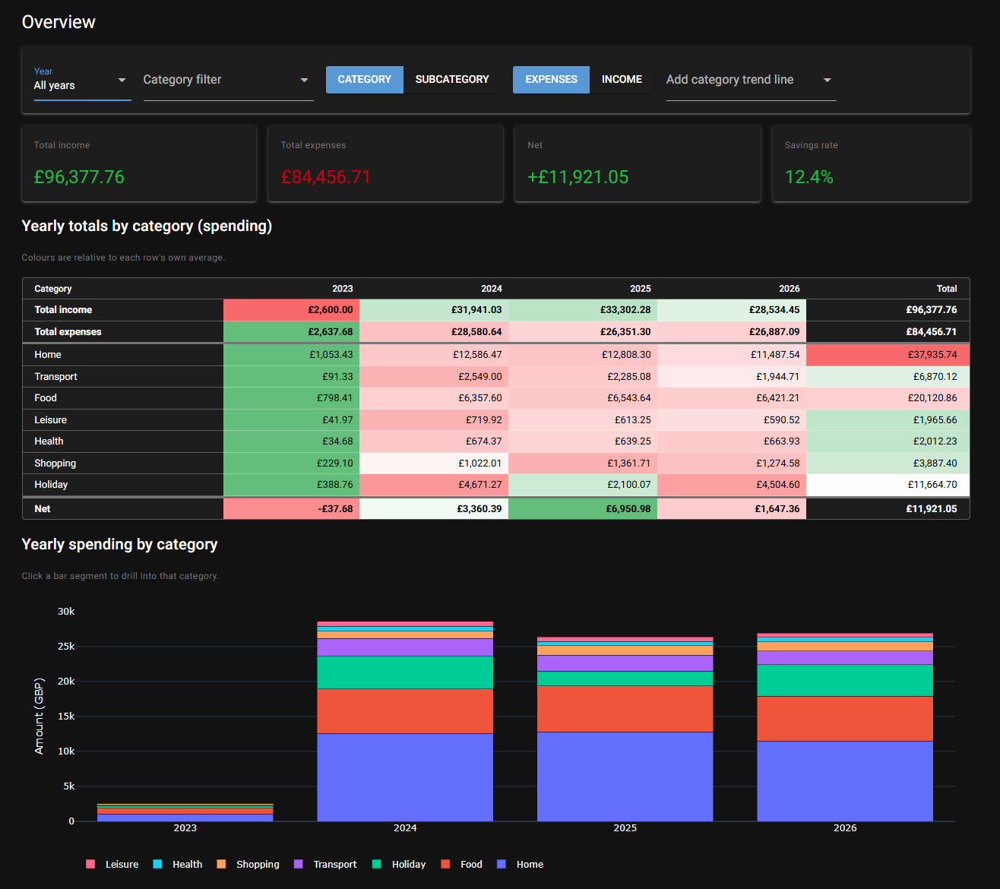

# Lantern

*A light on where your money goes.*

LANtern is a small, self-hosted personal finance tracker for your home network. Python, [NiceGUI](https://nicegui.io) for the whole UI, SQLite for storage, Plotly for charts.

- Multiple named users, each with their own transactions and categories, protected by per-user passwords. A device stays logged in until the user logs out or their password changes
- Two-level categories (category > subcategory), income and expense, in an order you choose
- Everything is recorded in one base currency; view it in any currency Frankfurter publishes rates for
- Recurring transactions (every N days, weeks or months) that wait in a review list, where you accept (optionally changing the amount) or reject each one
- Shared expenses: split a transaction between users (who paid and who owes, by amount or percentage). The others accept it into their own categories or reject it, each pair of users has a running balance, and one click settles it up
- Overview page with summary cards, a colour-scaled month x category table, drill-down charts and an income vs expenses chart
- Import transactions from a bank CSV, export your data as CSV, and back up or restore the whole database
- Runs directly with Python or in a Docker container



## Pages

| Page | Route | What it does |
| --- | --- | --- |
| Overview | `/` (also `/overview`) | Summary cards, month x category table, stacked monthly bars, income vs expenses, share pie |
| Add Transactions | `/transactions` | Add, filter, edit and delete transactions; share an expense with other users; manage recurring transactions; review recurring and shared items waiting for you |
| Shared Transactions | `/shared` | Balances with other users, settle up, and the list of shared transactions and settlements |
| Edit Categories | `/categories` | Add, rename, reorder and delete categories and subcategories |
| Export CSV | `/export` | Download transactions and/or month x category totals |
| Import CSV | `/import` | Load a bank CSV with automatic category matching |
| Backups | `/backups` | Save, download, upload, restore and delete database backups |

## Requirements

- Python 3.11 or newer (or just Docker, see below)
- Internet access is only needed for exchange rates. Without it the app still works, using cached rates or just the base currency.

## Install and run

```bash
cd lantern

python -m venv .venv
source .venv/bin/activate          # Windows: .venv\Scripts\activate

pip install -r requirements.txt

python main.py
```

Then open <http://localhost:8080>.

On first run the app asks for your **base currency** (default GBP) and for the name and password of the first user. Pick the base currency carefully: every amount is stored in it, so changing it later would change what your recorded numbers mean.

Every device shows a **login card** on its first visit: choose your name, enter your password, and the device stays logged in until you log out. Any logged-in user can add more users from the header. Passwords must be at least 4 characters.

Users without a password (for example, those created before passwords were added, or the demo user) are asked to **choose one** the first time they pick their name on the login card. Whoever gets there first sets it.

### Try it with demo data

```bash
python main.py --seed-demo
```

This creates a user called **Demo** with about three years of random transactions so you can see the charts. It does nothing if Demo already has transactions. The Demo user has no password; you will be asked to choose one the first time you log in as Demo.

### Run the tests

```bash
python test_shared.py          # database tests for shared transactions
python test_split_model.py     # tests for the split dialog's arithmetic
```

The database tests use a temporary database, so your `finance.db` is never touched.

## Run with Docker

The repository includes a `Dockerfile`, a `docker-compose.yml` and a `.dockerignore`.

```bash
docker compose up -d --build
```

Then open `http://<server-address>:8080`.

- **Data lives in a volume.** The database, the backups folder and the per-browser storage are all kept in `/data` inside the container, which docker-compose maps to the named volume `finance-data`. Rebuilding or recreating the container does not touch your data.
- **Time zone.** Set `TZ` so "today" and the current year match your local time (default `Europe/London`): `TZ=Europe/Paris docker compose up -d`, or edit `docker-compose.yml`.
- **Port.** To use a different host port, change the left side of the `ports` entry (for example `"9000:8080"`).
- **Logs:** `docker compose logs -f finance-tracker`
- **Stop:** `docker compose down` (add `-v` only if you want to delete the data volume too).
- **Update after changing the code:** `docker compose up -d --build`
- **Forgot a password:** `docker compose exec finance-tracker python main.py --reset-password NAME` (prompts for the new password; see "Resetting a password" below).

Without Compose:

```bash
docker build -t finance-tracker .
docker run -d --name finance-tracker --restart unless-stopped \
  -p 8080:8080 -e TZ=Europe/London -v finance-data:/data finance-tracker
```

Demo data in a container (stop it with Ctrl+C once it logs that the demo data is ready):

```bash
docker compose run --rm finance-tracker python main.py --seed-demo
```

If you prefer a folder on the host instead of a named volume, use a bind mount such as `./data:/data` and make it writable by user ID 1000 (`sudo chown -R 1000:1000 ./data`), because the container does not run as root.

### Backups with Docker

The Backups page saves into `/data/backups` in the volume. To copy them to the host:

```bash
docker compose cp finance-tracker:/data/backups ./backups
```

You can also make a backup from the command line:

```bash
docker compose exec finance-tracker python -c "import db; print(db.create_backup())"
```

## Open it from another device on your network

The server listens on all interfaces (`0.0.0.0`), so phones, tablets and other computers on the same network can use it.

1. Start the app. The log prints a line such as `From another device on your network: http://192.168.1.20:8080`. (Inside Docker this shows the container's address, so use the host machine's address instead.)
2. Open that address on the other device.
3. If it does not load, allow incoming connections to the port in the host machine's firewall (for example `sudo ufw allow 8080/tcp` on Ubuntu).

**Passwords protect your data, but the connection is not encrypted.** The app serves plain HTTP, so anyone who can watch the network traffic could read a password as it is sent. Only run it on a network you trust and do not expose the port to the internet. On a server, a good setup is to bind the port to localhost (`"127.0.0.1:8080:8080"` in `docker-compose.yml`) and put a reverse proxy with HTTPS (or a VPN) in front.

## Configuration

| Setting | How | Default |
| --- | --- | --- |
| Port | `--port 9000` or `FINANCE_PORT=9000` | `8080` |
| Database file | `FINANCE_DB_PATH=/path/to/finance.db` | `finance.db` next to `main.py` (`/data/finance.db` in Docker) |
| Backup folder | `FINANCE_BACKUP_DIR=/path/to/backups` | `backups/` next to `main.py` (`/data/backups` in Docker) |
| Per-browser storage folder | `NICEGUI_STORAGE_PATH=/path/to/.nicegui` | `.nicegui` next to `main.py` (`/data/.nicegui` in Docker) |
| Storage secret | `FINANCE_STORAGE_SECRET=...` | generated once and kept in the database |
| Time zone (Docker) | `TZ=Europe/London` | `Europe/London` in `docker-compose.yml` |

Each browser remembers its logged-in user, display currency and dark-mode choice. A device you have not used before (or whose cookies were cleared) shows the login card. Changing `FINANCE_STORAGE_SECRET` logs every device out.

### Resetting a password

Passwords can be reset from the command line on the machine running the app (nobody can reset another user's password from the web interface):

```bash
python main.py --reset-password NAME
docker compose exec finance-tracker python main.py --reset-password NAME
```

It asks for the new password twice, saves it and exits. That user is logged out on every device and must log in again with the new password.

## Using the app

### Logging in and users

- **Log in** from the card shown on each device. The login is remembered on that device until you use the **Log out** button in the header.
- **Add user** (header) lets any logged-in user create a new user with a name and password. You stay logged in as yourself; the new user logs in on their own device.
- **Change password** (key icon) asks for your current password. Your other devices are logged out and this one stays logged in.
- **Delete my account** (header) permanently deletes your own user and all their data after confirming your password. Users cannot delete each other. Deleting the last user returns the app to the first-run setup. It is blocked while you have unsettled shared balances or shared transactions waiting for you; once you are settled up, the shared records stay with the other users and show you as "Deleted user #n".
- After 5 wrong passwords a user is locked out for 5 minutes (this resets if the app restarts).

### Overview

- Pick a **year**, an optional **category filter**, **Category/Subcategory** level and **Expenses/Income**.
- **Summary cards:** total income, total expenses, net and savings rate for the year.
- **Month x category table:** each row is colour-scaled around its own monthly average (for spending, green is low and red is high; for income the scale is reversed). Rows follow the category order from the Categories page. It also has Total income, Total expenses and Net rows at the top and bottom, and a Total column that is scaled down the column. Months that have not happened yet in the current year are not coloured.
- **Charts:** stacked monthly bars and a share pie (small slices under 3% are merged into "Other"). Click a bar segment or pie slice to drill into that category. An income vs expenses chart with a net line is shown too.

### Add Transactions

Type the amount as a positive number and use the Income/Expense toggle to set the sign. Amounts are entered in the base currency; the table shows the current display currency. If you don't choose a subcategory, the transaction goes into that category's **Other** subcategory. You can filter by date, category (including its subcategories) and description, and edit or delete rows from the table.

Transactions that come from a shared split show a group icon and can't be edited or deleted here (see "Shared transactions" below).

#### Recurring transactions

Open **Recurring transactions** on this page and choose **New recurring transaction**. A rule has a type, amount, category, optional description, a first date and a repeat interval of *every N days, weeks or months*. Monthly rules keep their day of the month, falling back to the last day in shorter months (31 Jan, 28 Feb, 31 Mar).

- **Review list.** When you open the page, each occurrence whose date has passed appears in the **Recurring transactions awaiting review** card at the top. If you were away and several dates were missed, you get one item per missed date.
- **Accept** adds the item as a real transaction on its due date. The amount box lets you change the value first (for example a variable utility bill); the change applies to that one occurrence only. **Accept all** accepts everything using the amounts currently shown.
- **Reject** discards the item. Nothing is recorded.
- **Edit** a rule to change its amount, category, description, interval or **next date**. Changes affect future occurrences only; items already waiting for review keep their original values.
- **Stop** pauses a rule (it stays in the list, greyed out) and **Resume** restarts it. Dates that passed while it was stopped are skipped rather than added to the review list. **Delete** removes the rule and its waiting items; transactions you already accepted are kept.
- Deleting a category moves its recurring rules and waiting items to the replacement category you choose, along with its transactions.

### Shared transactions

Turn on **Share with other users** on the Add card (new expenses only; the switch is disabled until there is a second user). The Income/Expense toggle is locked to Expense and the button becomes **Set up split...**, which opens a dialog with the date, description, total and category from the form. Amounts are in the base currency.

1. Pick who is in the split (you are always in it, and at least one other person is needed).
2. For each person enter what they **paid** and what they **owe**, in currency or percent. The toggle above each column converts what you have typed. **Owes** starts as an even split and **Paid** as "you paid all"; the **Split evenly** and **Creator paid all** buttons put them back. A column stops following the total once you type in it. Each column shows what is left to assign, and **Create shared transaction** is enabled when both add up to the total.
3. Your share is added to your transactions straight away, and the switch turns itself off again. Everyone else gets a pending item in the **Shared transactions awaiting your review** card at the top of their Transactions page, where they choose an expense category and **Accept** or **Reject**. They can't change the amounts. Someone who owes nothing (for example, the person who paid everything) gets no transaction and no pending item.

The **Shared Transactions** page shows your balance with each person ("B owes you", "You owe B" or "All settled with B") and a list of shared transactions and settlements, newest first. Balances include shares that are still pending.

- **Mark as settled** records a settlement that zeroes the balance with one person, after asking you to confirm the amount. Either of you can click it. It fails with a "balance changed" message if the balance moved since you opened the dialog. Either of you can delete the settlement later, which brings the old balance back.
- **Reject** only works while your share is pending. It cancels the split for everyone, removes every personal copy and leaves a **Rejected** record in the list. Rejected records don't count in balances, and anyone in the split can delete one to clear it.
- **Delete** (the creator at any time, or a participant who has accepted) removes the shared transaction and every personal copy for everyone and leaves no record. Participants who are still pending use Reject instead.
- Shared transactions can't be edited. Delete and recreate instead.
- Because settlements are kept, deleting a shared transaction after settling it can flip the balance: the person who was owed now owes the difference back.

### Edit Categories

- Add top-level categories (income or expense) and subcategories (two levels maximum; subcategories take their parent's type).
- **Reorder** with the up/down arrows. This order is used in the dropdowns, the Overview table and the CSV export.
- Every category has a built-in **Other** subcategory, created the first time it is needed. It can't be renamed, moved or deleted on its own and always sits last.
- New users start with a default set of categories.
- A category can't be deleted while it has subcategories. If it has transactions you choose another category of the same type to move them to first.

### Export CSV

Download either or both of:

- **Transactions:** every transaction, oldest first, one row each.
- **Month x category totals:** one row per category and one column per month across all years, plus a Total column. Choose subcategory or category rows.

Amounts can be in the base currency or the current display currency. They are plain signed numbers with no symbol, and the files are UTF-8 with a BOM so Excel opens them correctly. If you tick both, two files download.

### Import CSV

1. Choose a CSV file (comma, semicolon or tab separated).
2. Check the guessed **date, amount, description and optional category columns** and the date format. Use **Flip sign** if your bank shows spending as positive.
3. **Preview.** Categories are matched from a category column in the file (if you pick one), then from descriptions you have used before (exact match first, then a known description appearing inside the new one, such as "Tesco" inside "TESCO STORES 3214"). Rows with no match are listed so you can pick a category for each or tick **Skip**; choosing one also fills other empty rows with the same description.
4. **Import.** With **Skip existing** on (the default), rows whose date, amount and category match a transaction already in the database are ignored. Rows within the file are never treated as duplicates of each other. Unreadable rows are listed and ignored.

Amounts in the file are read as the base currency. The import is all-or-nothing: if a row is invalid, nothing is added.

### Backups

- **Back up now** saves a complete copy of the database as `finance-YYYYMMDD-HHMMSS.db`, using SQLite's backup API, which is safe while the app is running.
- **Download** or **Delete** any backup, or **Add a backup file (.db)** to upload one. Uploaded files are checked first and kept as `uploaded-<name>.db`.
- **Restore** replaces the data of **all users** with the chosen backup. It first saves your current data as `pre-restore-<timestamp>.db`, so a restore can itself be undone. The signing secret is kept so open browsers stay valid. A device stays logged in only if that user exists in the restored backup with the same password; otherwise it shows the login card. Backups contain the password hashes (not the passwords), so keep them private. Older backups are upgraded to the current schema, and users in them without a password are asked to choose one.

## How it works

- **Amounts** are stored as signed integer minor units (pence/cents) in the base currency: income is positive, spending is negative. A category's type must match the sign of its transactions.
- **Logging in:** each user has a salted scrypt password hash in the `users` table (standard library `hashlib`, no extra dependency). After a successful login, the browser's `app.storage.user` holds the user id plus a token derived from that user's password hash. `state.get_current_user()` accepts the device only if the token still matches, so changing or resetting a password logs the user out everywhere. Failed logins are rate-limited per user in `state.try_login`. If the browser is not logged in, `build_layout()` shows the login card instead of the page.
- **Currency display:** the selector in the header converts amounts at display time only. Stored data is never changed. Amounts you type into the form, import from a file or export in base currency are always in the base currency.
- **Exchange rates** come from the free [Frankfurter](https://www.frankfurter.app) API and are cached in the database for 24 hours. If a refresh fails, the cached rates are used and a warning shows when they were last updated. After a failure it waits 10 minutes before trying again.
- **Database upgrades:** `db.init_db()` creates missing tables (including the recurring-transaction and shared-transaction tables, so older databases and backups pick them up automatically) and then runs small upgrades for databases from older versions (adding the `password_hash` column to `users`, adding category ordering, and moving any transactions filed directly on a top-level category into its Other subcategory).
- **Recurring transactions** are stored as rules (`recurring` table). Occurrence *i* falls on the start date plus *i* intervals, calculated from the start so month-end dates don't drift. When the Transactions page loads, `db.generate_pending` creates a row in `pending_transactions` for every occurrence dated before today (a unique index on rule and date prevents duplicates). Accepting a row inserts a normal transaction and removes the pending row.
- **Shared transactions** use three tables created by `SCHEMA`: `shared_transactions` (the header: creator, date, description, total, active or rejected), `shared_participants` (each person's paid and owed cents, accepted or pending, and a link to their personal transaction) and `settlements`. Paid and owed each add up to the total. A participant who owes something gets an ordinary personal transaction of minus their share, linked through `shared_participants.transaction_id`: the creator's is created immediately and everyone else's when they accept. `db.update_transaction` and `db.delete_transaction` refuse linked rows, so the Shared Transactions page is the only way to change them. Deleting removes the participant rows, then the personal copies, then the header, in that order because of the foreign keys.
- **Shared transaction maths** lives in `splits.py`, which imports nothing from the app. `percents_to_cents` turns percentages (which must add up to 100, give or take 0.05) into cents that add up exactly to the total, using largest-remainder rounding with ties going to the first person (the creator is always listed first), so 100.00 in thirds becomes 33.34 / 33.33 / 33.33. `pair_debts` takes each person's paid minus owed for one transaction and spreads every debtor's shortfall over the creditors in proportion to what they are owed.
- **Balances are never stored.** `db.shared_balances` works out one signed net per other user from the active shared transactions (pending included, rejected excluded) plus the settlement entries. Settling records a settlement for the whole balance after re-checking it, and no transaction is ever marked "settled". The user-id columns of the shared tables are deliberately not foreign keys, so a settled-up user can delete their account while the records stay with the others (new user ids are never reused, so a newcomer can't inherit a deleted user's history).

## Project structure

```
lantern/
  main.py              entry point: options (including --reset-password), route registration, ui.run()
  db.py                connection handling, schema, ALL SQL queries (including shared transactions and balances), password hashing, backups, demo data
  splits.py            shared-transaction maths: percentages to cents, who owes whom (no app imports)
  rates.py             exchange-rate fetching/caching, money parsing and formatting
  state.py             logged-in user (login, logout, rate limiting) and display currency (per browser)
  components.py        page frame: header, navigation, login card, user/password dialogs, first-run setup, currency picker
  shared_ui.py         reusable shared-transaction widgets: the split dialog and the pending-shares card
  pages/
    overview.py      cards, charts, month x category table                                    (routes: / and /overview)
    transactions.py  add/edit/delete form, share switch, recurring rules, review lists, filters and table    (route: /transactions)
    shared.py        balances, settle up, shared transactions and settlements list            (route: /shared)
    categories.py    manage and reorder categories                                            (route: /categories)
    export.py        CSV export                                                               (route: /export)
    import_csv.py    CSV import with category matching                                        (route: /import)
    backups.py       save, download, upload, restore backups                                  (route: /backups)
  test_shared.py       database tests for shared transactions
  test_split_model.py  tests for the split dialog's arithmetic
  requirements.txt
  Dockerfile
  docker-compose.yml
  .dockerignore
  README.md
```

Conventions worth knowing when you change things:

- All SQL lives in `db.py`. Pages call its functions and never write SQL.
- Problems a user can fix raise `db.DataError` with a friendly message; pages show it with `components.notify_error`.
- Every page starts with `ctx = await components.build_layout("Name")` and puts its content inside `with components.content():`.
- Money is always formatted through `rates.format_money` (usually via `ctx.display.money(cents)`).
- Every `db` function that touches shared transactions takes the acting `user_id` and checks they are a participant (or the right party) before doing anything.
- To add a page, create it in `pages/`, import it in `main.py` so its route registers, and add it to `NAV_LINKS` in `components.py`.

## Extending the app later

- **Automatic backups:** call `db.create_backup()` from a `ui.timer` (or `app.on_startup`) and prune old files. Manual backups already exist on the Backups page.
- **Budgets:** a `budgets(user_id, category_id, month, amount_cents)` table plus a progress bar per category on the overview page.
- **Schema changes:** add steps to `db._migrate()` (it checks for missing columns before altering tables). For bigger changes, consider a `PRAGMA user_version` check or a migration tool such as Alembic.
- **HTTPS:** terminate TLS in a reverse proxy (Caddy and nginx both work) so passwords are not sent in the clear.
- **Admin role:** add an `is_admin` flag on `users` if you want only some users to create users or reset passwords from the web.